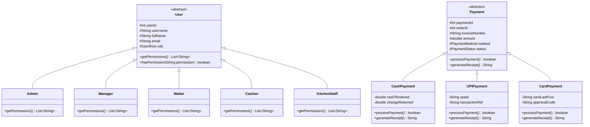

# Object-Oriented Class Hierarchy & Design Patterns

## 1. Class Diagram

## 2. Core OOP Principles Demonstrated

1. **Encapsulation**:
   - All properties in domain models are private/protected with explicit, validated getters and setters.
2. **Inheritance**:
   - `User` abstract parent class extended by `Admin`, `Manager`, `Waiter`, `Cashier`, `KitchenStaff`.
   - `Payment` abstract class extended by `CashPayment`, `UPIPayment`, `CardPayment`.
3. **Polymorphism**:
   - `Payment.processPayment()` executes specialized validation and receipt structuring dynamically at runtime depending on the payment mode selected.
4. **Abstraction & Interfaces**:
   - Distinct generic Repository interfaces (`IRepository<T, ID>`) and Service contracts.
5. **Data Structures in Action**:
   - `PriorityQueue<KitchenOrder>` orders incoming kitchen tickets prioritized by waiting duration & cooking urgency.
   - `HashMap<Integer, MenuItem>` provides O(1) in-memory lookups for rapid bill aggregation.
   - `SearchSortUtil` implements binary search and quicksort on menu collections.
