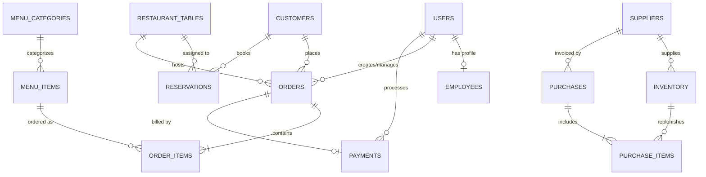

# Database Design & Entity Relationship (ER) Documentation

## 1. Database Schema Overview
The database `restaurant_management` consists of 14 normalized tables designed up to **3NF (Third Normal Form)** with strict referential integrity.

## 2. Entity-Relationship (ER) Diagram

## 3. Detailed Table Dictionary

### 1. `users`
- `user_id` (PK, INT AUTO_INCREMENT): Primary identifier.
- `username` (VARCHAR 50, UNIQUE, NOT NULL): Login name.
- `password_hash` (VARCHAR 255, NOT NULL): SHA-256 salted hash.
- `salt` (VARCHAR 64, NOT NULL): Unique random salt.
- `role` (ENUM: ADMIN, MANAGER, WAITER, CASHIER, KITCHEN_STAFF).
- `is_active` (BOOLEAN): Soft-delete flag.

### 2. `employees`
- `employee_id` (PK, INT AUTO_INCREMENT).
- `user_id` (FK to `users.user_id`, UNIQUE, NOT NULL).
- `designation`, `salary`, `hire_date`, `shift_timing`, `emergency_contact`.

### 3. `customers`
- `customer_id` (PK, INT AUTO_INCREMENT).
- `name`, `phone` (UNIQUE), `email`, `address`.
- `loyalty_points`, `total_visits`, `total_spent`.

### 4. `restaurant_tables`
- `table_id` (PK, INT AUTO_INCREMENT).
- `table_number` (VARCHAR 10, UNIQUE).
- `capacity` (INT, CHECK > 0).
- `status` (ENUM: AVAILABLE, OCCUPIED, RESERVED, CLEANING).

### 5. `menu_categories` & `menu_items`
- Categorization with display ordering.
- `menu_items` stores price, prep time, availability status, and description.

### 6. `orders` & `order_items`
- Represents full billable transaction life cycle.
- Calculates `subtotal`, `discount_amount`, `tax_amount`, `service_charge`, `total_amount`.
- Status flow: `CREATED -> CONFIRMED -> PREPARING -> READY -> SERVED -> COMPLETED / CANCELLED`.

### 7. `payments`
- Unique `invoice_number` and `order_id` FK.
- Payment method (CASH, UPI, CREDIT_CARD, DEBIT_CARD).
- Audited with `processed_by` cashier user ID.

### 8. `inventory`, `suppliers`, `purchases`, `purchase_items`
- Stock management with `minimum_stock` trigger for Low-Stock alerts.
- Supplier purchase invoices and restock logging.
