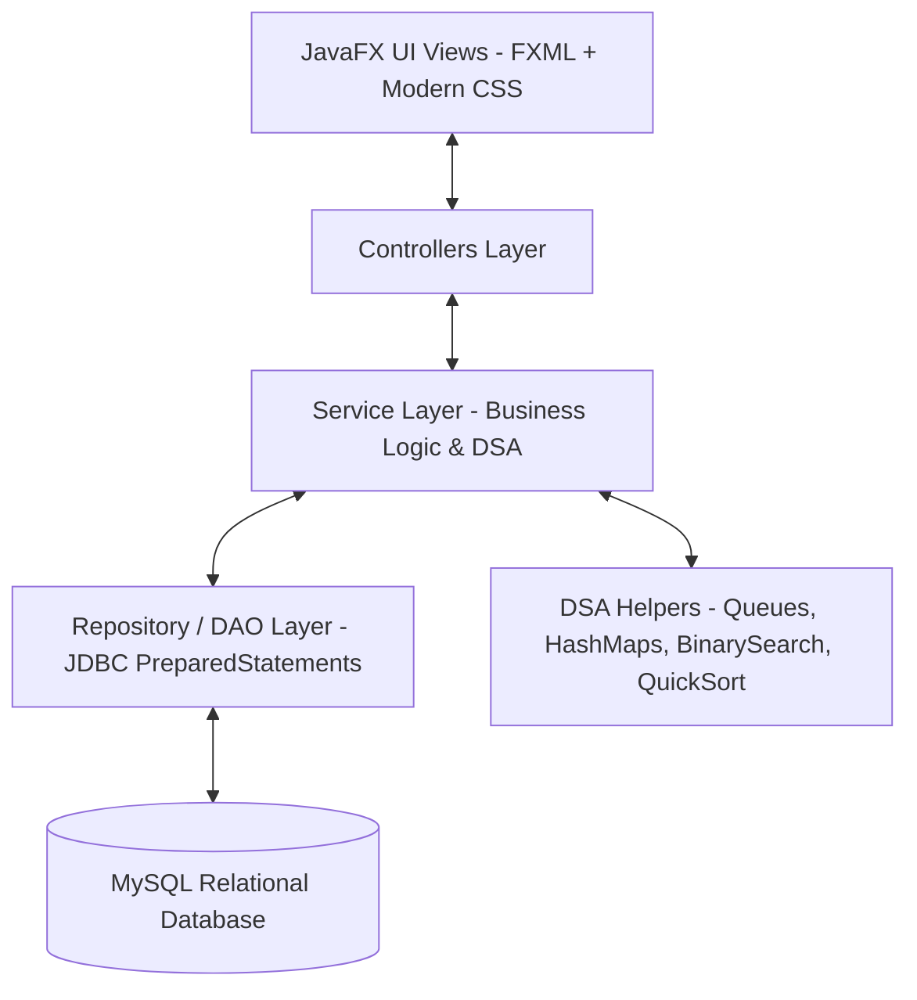

# System Architecture — Restaurant Management System (RMS)

## 1. Architectural Overview
The Restaurant Management System is designed following a **Layered MVC (Model-View-Controller)** pattern with distinct separation of concerns, enterprise Java conventions, and clean abstraction boundaries.

## 2. Layer Breakdown

### A. Presentation Layer (JavaFX + FXML + CSS)
- **FXML Views**: Declarative UI layout definitions ensuring total decoupling from business logic.
- **CSS Styling**: Unified design system featuring glassmorphic accents, status color badges, and fluid layout scaling.
- **Controllers**: Event listeners binding UI controls to service layer invocations.

### B. Service Layer (Business Logic & Transactions)
- Enforces domain rules (e.g. table double-booking prevention, automated bill recalculations, inventory threshold alerts).
- Houses custom data structure workflows (Priority Kitchen Queue, Customer Loyalty calculation).

### C. Data Access Layer (Repository / DAO)
- Encapsulates direct JDBC connectivity.
- Guaranteed protection against SQL Injection using `PreparedStatement`.
- Resource management using `try-with-resources`.

### D. Model & Domain Entities
- Strongly typed Java classes with complete encapsulation (private fields, getters/setters, domain constructors).
- Inherited hierarchies for Users and Polymorphic Payment strategies.

### E. Configuration & Utilities
- Thread-safe Singleton Database connection provider (`DatabaseConfig`).
- Cryptographic password hashing (`PasswordUtil`) using salted SHA-256.
- Robust formatting (`CurrencyUtil`, `DateTimeUtil`) and input sanitization (`ValidationUtil`).

## 3. Key Design Patterns Demonstrated
1. **Model-View-Controller (MVC)**: Clean decoupling of view, logic, and state.
2. **Data Access Object (DAO)**: Standardized CRUD abstraction.
3. **Singleton Pattern**: Managed database connection lifecycle and application configuration.
4. **Strategy / Polymorphism Pattern**: Uniform interface `PaymentStrategy` with specialized implementations (`CashPayment`, `UPIPayment`, `CardPayment`).
5. **Factory / Builder Pattern**: Dynamic receipt builder and order item aggregators.
